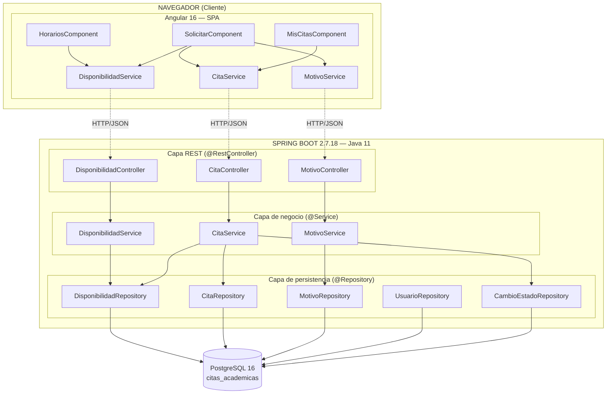

# Arquitectura Web 3.0 — PR02 Sistema de Citas Académicas

**Actividad:** P04
**Equipo:** Uriel Cruz Herrera, Erick Romero García, Josue Sánchez Valente
**Fecha:** Octubre 2026

---

## 1. Propósito

Diseñar la arquitectura Web 3.0 del proyecto PR02, desacoplando frontend (Angular) y backend (Spring Boot), con persistencia en PostgreSQL 16 y comunicación vía API REST/JSON.

## 2. Diagrama de componentes



## 3. Explicación de capas

| Capa | Componente | Responsabilidad | Por qué existe |
| :--- | :--- | :--- | :--- |
| **Presentación** | Componentes Angular (`HorariosComponent`, `SolicitarComponent`, `MisCitasComponent`) | Renderizar interfaz, capturar eventos del usuario, mostrar mensajes de error. | Separar UX del dominio. Permite cambiar la interfaz sin tocar el backend. |
| **Comunicación cliente** | Servicios Angular (`CitaService`, `DisponibilidadService`, `MotivoService`) | Realizar peticiones HTTP al backend, transformar respuestas JSON a modelos TypeScript. | Centralizar el acceso a la API; un solo lugar para cambiar URLs y manejo de errores. |
| **Exposición HTTP** | `@RestController` en Spring Boot | Recibir peticiones HTTP, validar formato, delegar a la capa de servicio, devolver JSON. | Puerta de entrada a la lógica del negocio; no debe contener reglas. |
| **Negocio** | `@Service` | Aplicar reglas de negocio (ej. impedir doble reserva, validar transiciones de estado). Transaccionalidad. | Es el corazón del sistema. Aquí vive "lo que el sistema sabe hacer". |
| **Persistencia** | `@Repository` (Spring Data JPA) | Traducir objetos Java ↔ filas de PostgreSQL. Ejecutar consultas. | Aislar el código de negocio del motor de BD. Cambiar a otro motor sería más fácil. |
| **Base de datos** | PostgreSQL 16 | Almacenar datos con integridad referencial, CHECK constraints y UNIQUE. | Fuente única de verdad. Los datos no deben vivir en el cliente. |

## 4. Decisiones arquitectónicas y alternativas consideradas

### 4.1 ¿Por qué Angular y no React o Vue?

| Criterio | Angular 16 | React | Vue |
| :--- | :--- | :--- | :--- |
| Curva de aprendizaje | Alta (TypeScript obligatorio, RxJS, DI) | Media | Baja |
| Opinión del framework | **Framework completo con opinión** (rutas, HTTP, formularios, DI integrados) | Librería; requiere elegir router, state manager, etc. | Framework progresivo |
| Soporte empresarial | Google | Meta (comunidad) | Comunidad |
| Decisión | **Elegido por el curso** | — | — |

**Justificación:** Angular es el estándar didáctico del curso. Su modelo de inyección de dependencias y separación en componentes refuerza los conceptos arquitectónicos que se evalúan. Además, su CLI provee estructura consistente.

**Nota sobre la versión de Angular**: Se usó Angular 16 en lugar de la última versión (18+) porque el curso estandariza en 16.2.12 y el material didáctico asume esa versión. La instalación se hizo con `npx -p @angular/cli@16` para no afectar otras instalaciones globales.

### 4.2 ¿Por qué Spring Boot y no Jakarta EE puro, Quarkus o Micronaut?

| Criterio | Spring Boot 2.7.18 | Jakarta EE | Quarkus |
| :--- | :--- | :--- | :--- |
| Compatibilidad con Java 11 |  Sí |  Sí |  Requiere Java 11+ pero optimizado para 17+ |
| Ecosistema y documentación | Muy amplio | Amplio | Creciente |
| Auto-configuración |  Excelente |  Manual |  Sí |
| Curva de aprendizaje | Media | Alta | Media |
| Decisión |  **Elegido por el curso** | — | — |

**Justificación:** Spring Boot permite arrancar un proyecto REST con mínima configuración. Spring Data JPA elimina el boilerplate JDBC que usamos en P02 (Web 1.0), mostrando la evolución natural de la arquitectura.

**Nota sobre las versiones**: Spring Initializr ya no ofrece Spring Boot 2.7.18 ni Java 11. Se adoptó **Spring Boot 4.1.1 + Java 17** (el mínimo requerido por el framework). El único cambio de código respecto al material del curso fue migrar los imports JPA de `javax.persistence.*` a `jakarta.persistence.*` (obligatorio desde Spring Boot 3+). La arquitectura en capas y el modelo de datos se mantienen idénticos.

### 4.3 ¿Por qué DTOs en vez de exponer las entidades JPA directamente?

**Alternativa considerada:** Devolver `Cita` (entity) directamente en el JSON.

**Razón del descarte:**
- Expone la estructura interna de la BD (IDs, FKs).
- Acopla el contrato REST a cambios en el modelo de datos.
- Puede filtrar datos sensibles (ej. `password_hash` de `usuario`).

**Decisión:** Usar `CitaRequestDTO` y `CitaResponseDTO` como contrato público. Las entidades JPA se mantienen privadas en el backend.

### 4.4 ¿Por qué mantener el mismo modelo PostgreSQL de P02?

**Alternativa considerada:** Rediseñar el modelo desde cero para Web 3.0.

**Razón del descarte:**
- Los datos son los mismos: un estudiante, un asesor, un horario, una cita.
- El curso enfatiza la **trazabilidad acumulativa**: P02 → P03 → P04 → ...
- Rediseñar rompería la continuidad del proyecto.

**Decisión:** Reutilizar el esquema de P02 migrándolo a anotaciones JPA.

### 4.5 Adaptación a Spring Boot 4.1 y Java 17

**Contexto**: Spring Initializr ya no ofrece Spring Boot 2.7.18 ni Java 11. Se adoptó Spring Boot 4.1.1 con Java 17, que es el mínimo requerido por el framework[reference:5].

**Impacto**: 
- Migración de `javax.persistence.*` a `jakarta.persistence.*` en todas las entidades JPA[reference:6].
- Se mantiene la misma arquitectura de capas y el mismo modelo de datos.

## 5. Trazabilidad RF → Componente

| RF | Descripción | Backend | Frontend | Endpoint | Estado |
| :--- | :--- | :--- | :--- | :--- | :---: |
| RF01 | Disponibilidad | `DisponibilidadController` | `HorariosComponent` | `GET /api/disponibilidades` | ✅ |
| RF02 | Solicitud | `CitaController.crear()` | `SolicitarComponent` | `POST /api/citas` | ✅ |
| RF03 | Confirmación | (pendiente P05) | (pendiente P05) | — | ⏳ |
| RF04 | Cancelación | `CitaController.cancelar()` | `MisCitasComponent` | `DELETE /api/citas/{id}` | ✅ |
| RF05 | Estado y consulta | `CitaController.listar()` | `MisCitasComponent` | `GET /api/citas` | ✅ |
| RF06 | Persistencia | Entidades JPA + Repositories | — | — | ✅ |
| RF07 | API REST + Angular | Todos los Controllers | Todos los Services | — | ✅ |
| RF08 | IoT (Web 4.0) | — | — | — | ⏳ P07 |

## 6. Seguridad básica implementada

| Riesgo | Control en P04 |
| :--- | :--- |
| Credenciales expuestas | Uso de variables de entorno (`SPRING_DATASOURCE_*`). Sin contraseñas en `application.properties`. |
| Datos sensibles en JSON | DTOs públicos sin campos internos; sin `password_hash`. |
| CORS bloqueado/abierto | Configuración `CorsConfiguration` limitada a `http://localhost:4200` en desarrollo. |
| Doble reserva (concurrencia) | Restricción `UNIQUE` en `cita.id_disponibilidad` + transacción `@Transactional` en `CitaService.crear()`. |
| Datos reales | Todos los datos son sintéticos y ficticios. |

## 7. Despliegue

| Componente | Puerto | Comando de arranque |
| :--- | :--- | :--- |
| Backend Spring Boot | 8080 | `mvn spring-boot:run` |
| Frontend Angular | 4200 | `npm start` |
| PostgreSQL | 5432 | Servicio local |
| Tomcat 9 | — | **NO se usa en P04** (solo Spring Boot embebido). |

## 8. Estructura de carpetas

```
P04/
├── backend-citas/              ← Spring Boot
│   ├── pom.xml
│   └── src/main/java/mx/uv/dsw/citas/
│       ├── CitasApplication.java
│       ├── controller/
│       ├── service/
│       ├── repository/
│       ├── entity/
│       ├── dto/
│       └── config/
├── frontend-citas/             ← Angular 16
│   ├── package.json
│   └── src/app/
│       ├── components/
│       ├── services/
│       └── models/
├── sql/
│   ├── 01_schema.sql
│   └── 02_datos_prueba.sql
└── docs/
    ├── arquitectura.md
    ├── openapi.yaml
    └── contribucion-individual.md
```

## 9. Limitaciones declaradas

- **VERIFICADO**: Estructura de carpetas y arranque de backend (health endpoint).
- **VERIFICADO**: Arranque de Angular 16 en `localhost:4200`.
- **NO_VERIFICADO**: Llamada desde Angular a backend (se implementará en FASE 2).
- **PENDIENTE**: Autenticación real (queda para Web 2.0).
- **PENDIENTE**: IoT / Web 4.0 (queda para P07).

## Nota sobre los datos de prueba

Los bloques de disponibilidad usan `CURRENT_DATE + INTERVAL` para garantizar
que siempre haya horarios futuros al momento de ejecutar los scripts.
Si el sistema se prueba después de varios días, re-ejecutar `02_datos_prueba.sql`.